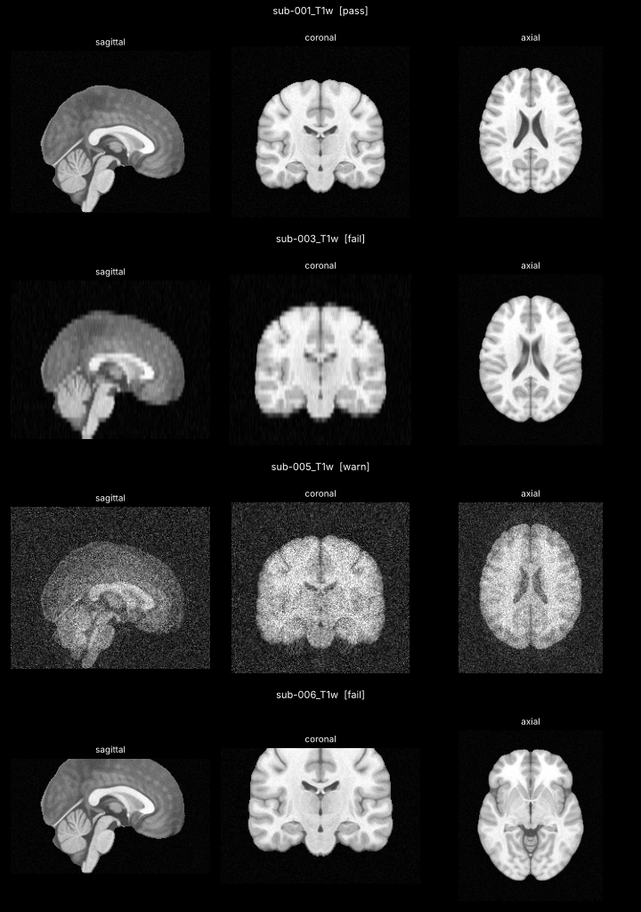

# t1-qc: quality control and cataloging for clinical T1 brain MRI

AI models for detecting early Alzheimer's disease from structural MRI are usually built on research datasets such as ADNI, where every scan follows the same high-quality protocol. Hospital archives look nothing like that. The same archive mixes vendors and field strengths, 2D clinical stacks with 5 mm slices, motion, contrast-enhanced studies, FLAIRs filed next to T1s, and files that never finished transferring.

If those scans reach a segmentation tool or a classifier unchecked, the model doesn't crash. It returns a confident number that is wrong. **t1-qc is the step before the model:** it reads every scan, decides whether it is fit for volumetric analysis, says why not when it isn't, and writes a catalog that the rest of the pipeline (segmentation, model inference, subgroup evaluation) can filter and join on.


*Top to bottom: a clean 3D T1 (pass), a 5 mm 2D clinical stack (fail), a noisy, motion-degraded scan (warn), and a scan whose field of view cut off the top of the brain (fail).*

## What it does

```
folder of NIfTI scans (+ dcm2niix JSON sidecars)
        │
        ├─ metadata   scanner, field strength, 2D/3D, sequence, contrast, age band, sex, indication
        ├─ geometry   dimensions, voxel size, anisotropy, field-of-view extent, orientation
        ├─ intensity  Otsu foreground mask, SNR, NaN/Inf voxels, empty volumes
        ├─ coverage   tissue touching the volume border (head cut off by the field of view)
        │
        ▼
rule-based QC (thresholds in config/default.yaml) ──► pass / warn / fail + reasons
        │
        ▼
catalog.csv · cohort_summary.md (QC by scanner, field strength, 2D/3D, indication, sex)
report.html (one card per scan with its slice montage) · montages/*.png
```

## Checks

| Check | Why it matters | Default |
|---|---|---|
| Sequence is T1-weighted | Models and segmentation tools expect T1 contrast. FLAIR, T2, DWI and localizers are excluded before keyword matching so "T1 FLAIR" doesn't slip through | fail if another sequence, warn if unknown |
| Slice thickness | Clinical 2D stacks (≥3 mm) lose the detail needed to measure hippocampal volume | warn > 1.5 mm, fail > 3 mm |
| Voxel anisotropy | Very uneven voxels distort shape-based features | warn > 2 |
| Field-of-view extent | Partial-brain acquisitions can't give whole-brain measures | fail < 140 mm |
| NaN / Inf voxels | A sign of corrupted reconstruction or export | fail if any |
| Empty volume | Blank or near-blank images | fail if < 5% foreground |
| SNR (foreground mean / background SD) | Noise and motion degrade segmentation | warn < 8, fail < 4 |
| Head cut off | Tissue on a border face means the field of view clipped the brain | warn > 5%, fail > 15% of a face |
| Contrast agent | Gadolinium changes T1 appearance; most models were trained without it | warn |
| Unreadable file | Truncated or corrupt files are caught and logged, never crash the run | fail |

A scan's status is the worst of its checks. Every reason is recorded, so exclusions can be reported and audited. That matters, because systematically dropping one scanner type or one patient group biases everything downstream.

Thresholds live in YAML because they depend on the next step: SynthSeg handles thick clinical slices far better than FreeSurfer `recon-all`, so a SynthSeg pipeline can relax the slice-thickness rule.

## Demo

There's no patient data in this repo. `scripts/make_demo_data.py` builds 11 scans from the MNI152 T1 template bundled with nilearn (a skull-stripped average brain) and degrades each one to imitate a real clinical failure mode. The sidecars carry fictional metadata.

```bash
pip install -r requirements.txt
python scripts/make_demo_data.py --out data/demo
python -m t1qc.cli data/demo --out results
open results/report.html
```

| Scan | Simulated problem | Status | Reasons |
|---|---|---|---|
| sub-001 | none (3D MPRAGE, Siemens 3T) | **pass** | all checks passed |
| sub-002 | none (3D SPGR, GE 1.5T, more noise) | **pass** | all checks passed |
| sub-003 | 2D axial stack, 5 mm slices | **fail** | thick slices (5.0 mm); anisotropic voxels (5.0) |
| sub-004 | 2 mm slices | **warn** | slices thicker than research grade (2.0 mm) |
| sub-005 | motion ghosting + noise | **warn** | low SNR (7.5); noise or motion likely |
| sub-006 | top of brain outside the field of view | **fail** | partial coverage (134 mm); head cut off (20% of a border face is tissue) |
| sub-007 | block of NaN voxels | **fail** | corrupted voxels (0.41% NaN/Inf) |
| sub-008 | FLAIR filed with the T1s | **fail** | not a T1-weighted series (AX T2 FLAIR) |
| sub-009 | gadolinium post-contrast | **warn** | contrast-enhanced (Gadobutrol) |
| sub-010 | no metadata sidecar | **warn** | sequence type unknown |
| sub-011 | truncated transfer | **fail** | unreadable: compressed file ended early |

## Using it on real data

1. Convert DICOM to NIfTI with [`dcm2niix`](https://github.com/rordenlab/dcm2niix) (`dcm2niix -b y -z y -o out/ dicom_dir/`). The `-b y` flag writes the JSON sidecars t1-qc reads.
2. Join scan indication and de-identified demographics into the sidecars, or merge them into `catalog.csv` afterwards on `scan_id`.
3. Run `python -m t1qc.cli /path/to/nifti --out qc_run_01`.
4. Visually review every `warn` and a random sample of `pass` scans in `report.html`. Automated metrics miss things that are obvious to the eye.

To catalog DICOM series before converting anything, `t1qc.io.read_dicom_series_header()` reads the header fields without loading pixel data.

## Tests

```bash
python -m pytest -q   # 14 tests on synthetic phantoms, no data needed
```

## Limitations and next steps

- SNR here is a simple foreground/background ratio. [MRIQC](https://mriqc.readthedocs.io) computes a much richer set of image-quality metrics (CJV, EFC, FBER and more) and would be the next addition.
- Sequence detection relies on SeriesDescription keywords, which vary by site. A small classifier on header fields would be more robust.
- Next stage: run [SynthSeg](https://github.com/BBillot/SynthSeg) on passing scans, add its per-scan QC scores and regional volumes (normalized by intracranial volume) to the catalog, and flag implausible volumes.
- Thresholds were chosen from the literature and common practice, not tuned against expert ratings. Calibrating them against a manually rated sample would be the right way to set them for a specific archive.

## Project layout

```
t1qc/io.py        scan discovery, NIfTI loading, JSON sidecar and DICOM header reading
t1qc/metrics.py   geometry, Otsu foreground mask, SNR, border coverage
t1qc/rules.py     sequence classification and pass/warn/fail rules
t1qc/report.py    montages, cohort tables, HTML report
t1qc/pipeline.py  runs everything and writes outputs
t1qc/cli.py       command line entry point
config/           QC thresholds
scripts/          demo data generator
tests/            unit and end-to-end tests
```

Imaging data and outputs are gitignored on purpose. Scans should never be committed to a repository.

---
**Purvi Dalal**, MS in Data Science, Columbia University
